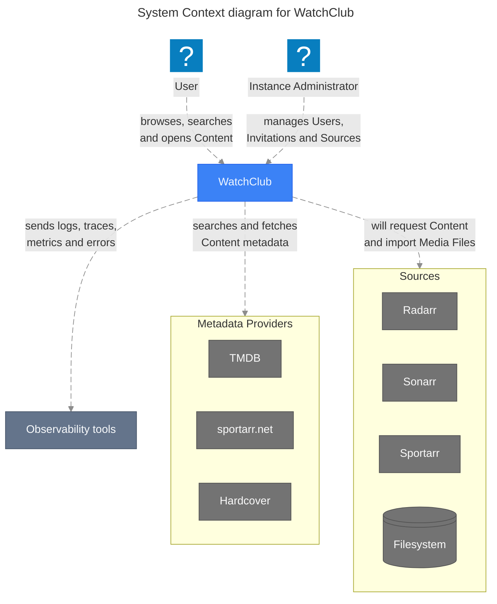
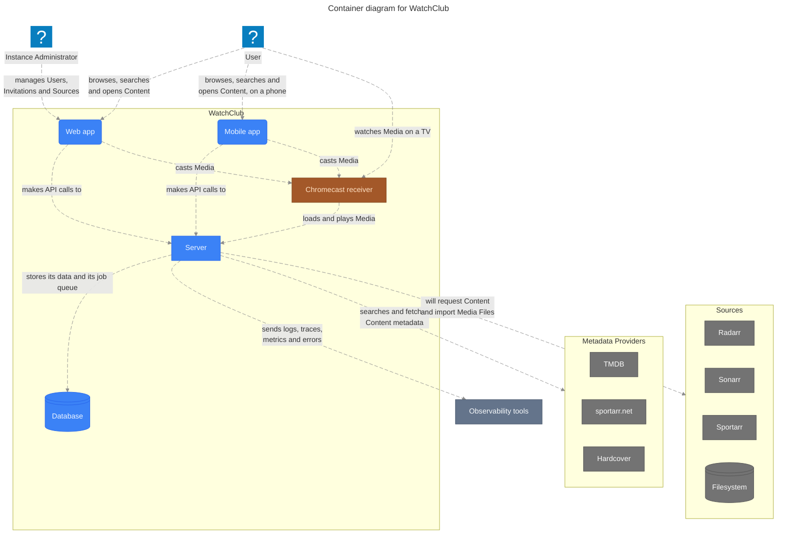
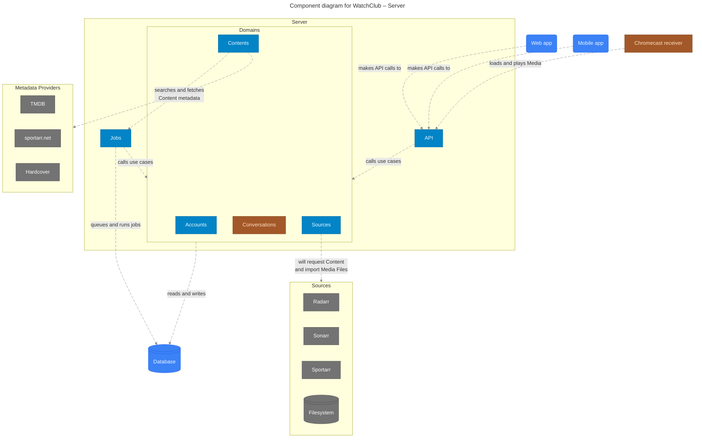
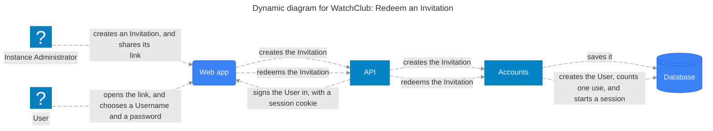
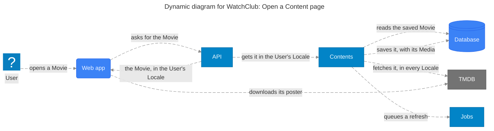
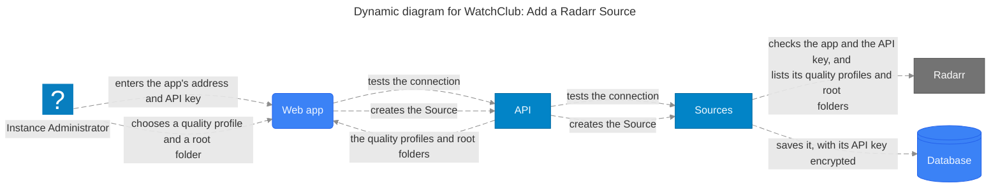
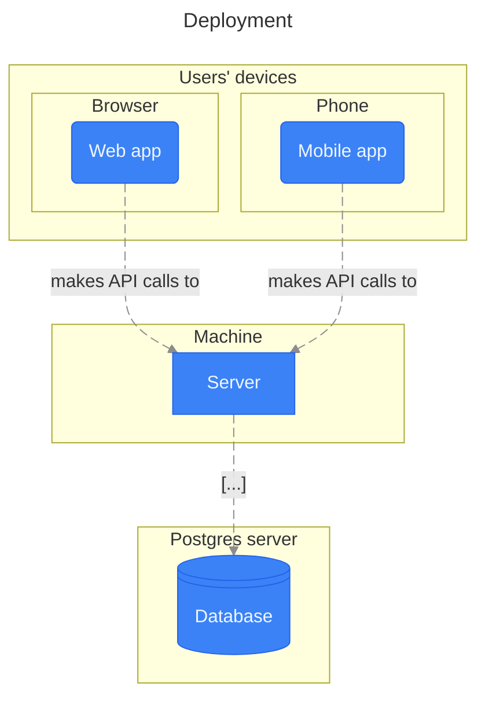

<!-- Generated by likec4 export markdown. Do not edit manually. -->

# WatchClub architecture

### System Context diagram for WatchClub

Who uses WatchClub, and the systems it calls. Dashed frames group what's inside them, and an
arrow to a frame stands for arrows to what's inside. The small grey box is optional.

### Container diagram for WatchClub

The apps share their logic in `packages/core`. They also download posters from the Metadata
Providers, and send their errors to Sentry. Amber shows what isn't built yet. Dashed frames
group what's inside them, and an arrow to a frame stands for arrows to what's inside. The
small grey box is optional.

### Component diagram for WatchClub – Server

The API and the jobs are the entry points. Each domain has its module in
`apps/server/src/domain`, and its folder in `packages/core/src`. Amber shows what isn't built
yet. Dashed frames group what's inside them, and an arrow to a frame stands for arrows to
what's inside.

### Dynamic diagram for WatchClub: Redeem an Invitation

The Instance Administrator shares an Invitation's link, and a new person creates their User
with it.

### Dynamic diagram for WatchClub: Open a Content page

A User opens a Movie's page. The first time anyone opens it, WatchClub saves it from TMDB,
so later views don't wait for TMDB.

### Dynamic diagram for WatchClub: Add a Radarr Source

The Instance Administrator connects a Radarr app, and chooses how it downloads Movies.
Sonarr and Sportarr Sources work the same way.

### Dynamic diagram for WatchClub: Recommend Content

A User recommends a Content to other Users, which starts a Conversation that shows in each
Participant's Inbox. Amber shows what isn't built yet: here, Conversations.

```mermaid
---
title: "Dynamic diagram for WatchClub: Recommend Content"
---
graph LR
  User@{ icon: "fa:user", shape: rounded, label: "User" }
  WatchclubWeb@{ shape: rounded, label: "Web app" }
  WatchclubServerApi@{ shape: rectangle, label: "API" }
  WatchclubServerDomainsConversations@{ shape: rectangle, label: "Conversations" }
  WatchclubDatabase@{ shape: disk, label: "Database" }
  User -. "`recommends a Content to other Users, 
with some text`" .-> WatchclubWeb
  WatchclubWeb -. "`recommends the Content`" .-> WatchclubServerApi
  WatchclubServerApi -. "`starts a Conversation`" .-> WatchclubServerDomainsConversations
  WatchclubServerDomainsConversations -. "`saves the Conversation, its Participants 
and its first Message`" .-> WatchclubDatabase
  classDef primary fill:#3b82f6,stroke:#2563eb,color:#eff6ff
  class WatchclubWeb,WatchclubDatabase primary
  classDef sky fill:#0284c7,stroke:#0369a1,color:#f0f9ff
  class WatchclubServerApi sky
  classDef amber fill:#A35829,stroke:#7E451D,color:#FFE0C2
  class WatchclubServerDomainsConversations amber
  linkStyle 0,1,2,3 stroke:#8D8D8D,stroke-dasharray:8 4
```

### Deployment

An Instance: WatchClub's Docker image, with a Postgres database. Users open the web app in
a browser, or the mobile app on their phones.

