# Data model

The database, one class diagram per domain. Standard `inserted_at` and `updated_at` columns are left out. A class from another domain shows with its name only.

## Accounts

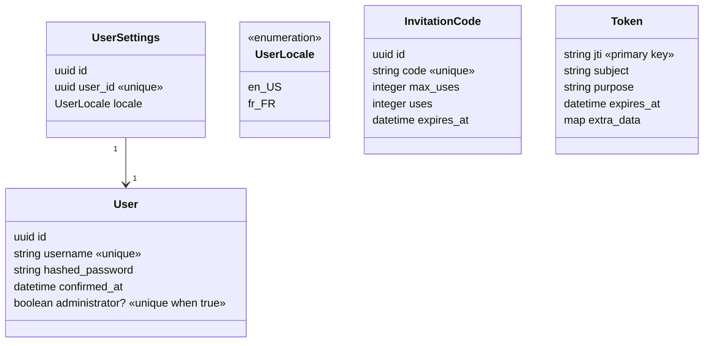

## Instance

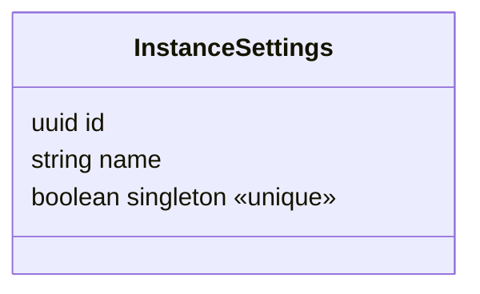

## Contents

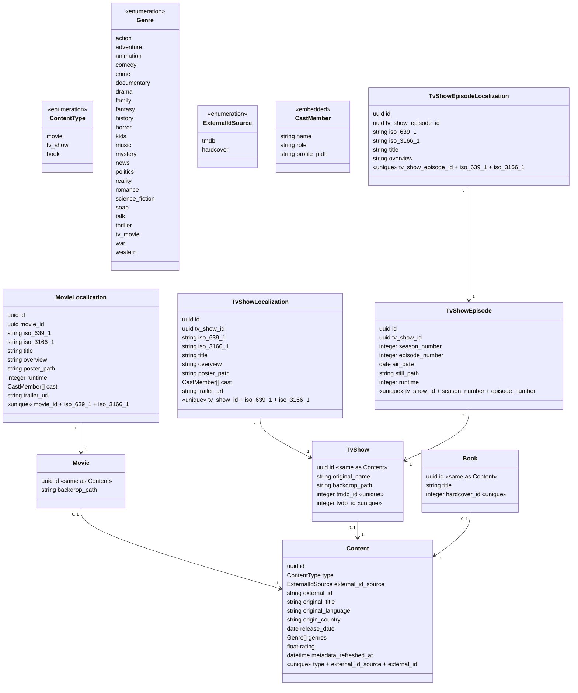

## Media Catalog

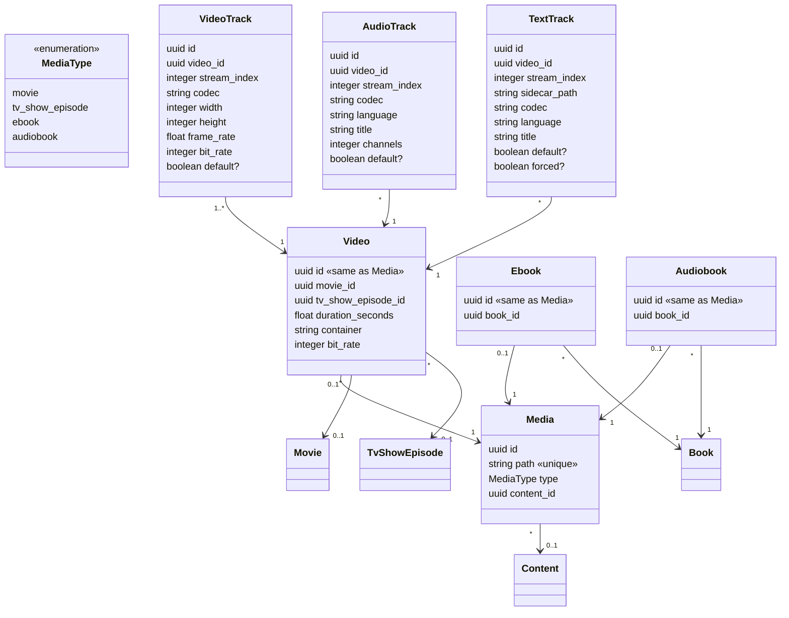

## Media Sources

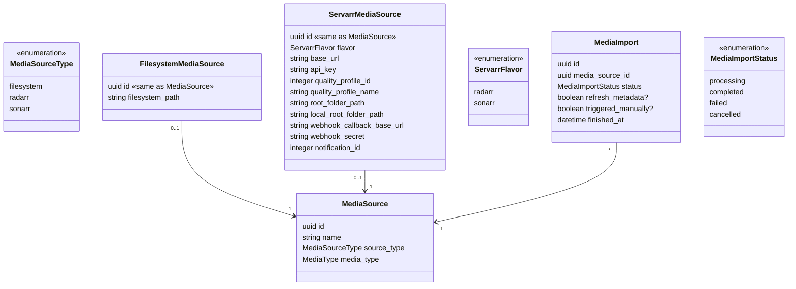

## Playbacks

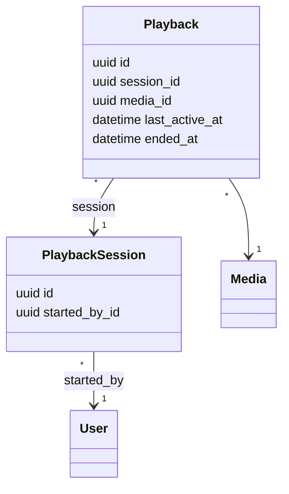

## History

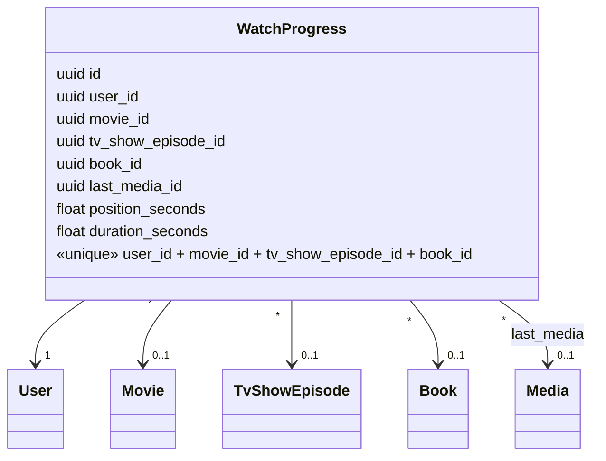

## Requests

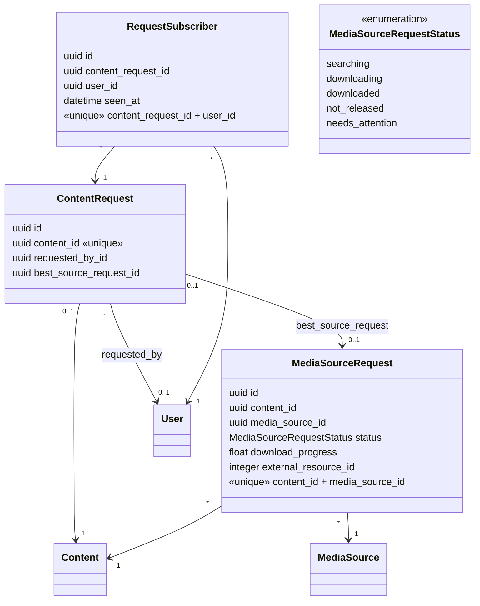

## Playlists

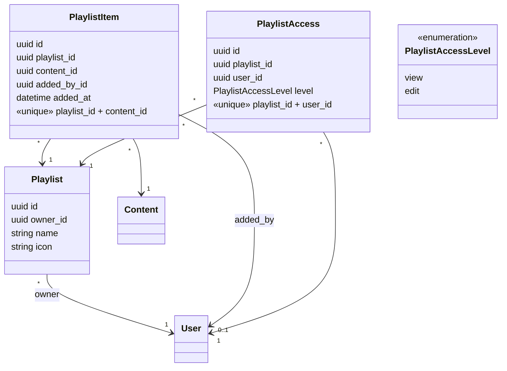

## Conversations

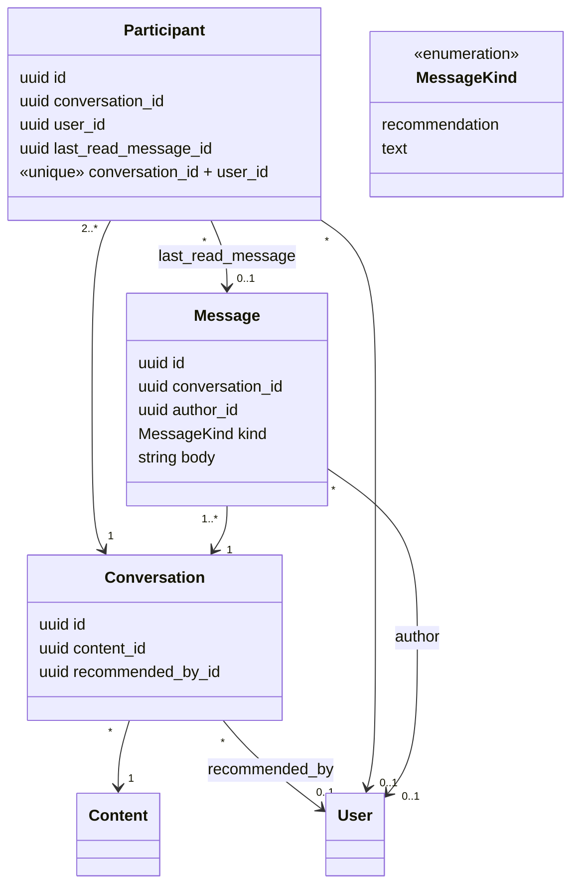

## Activity Feed

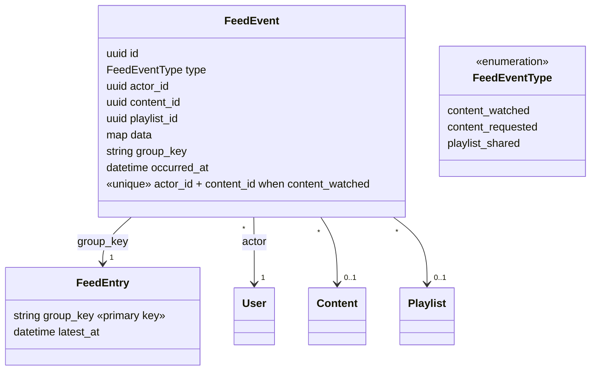
