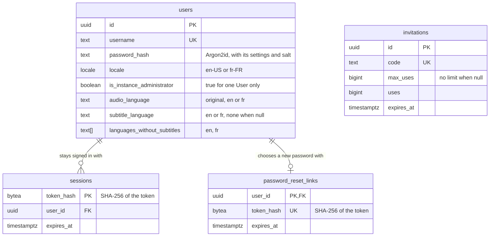
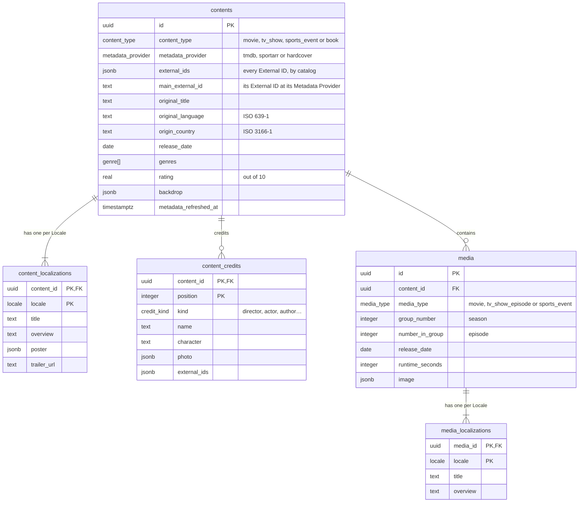
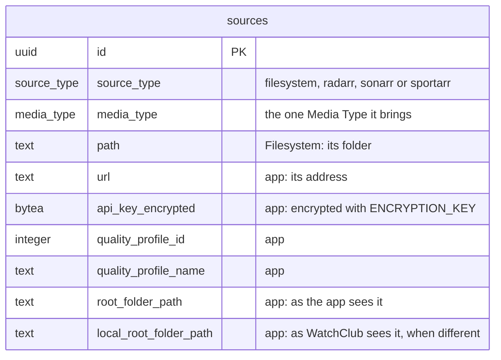
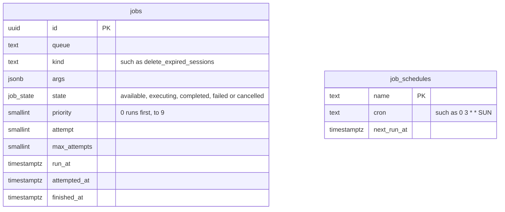

# Data model

WatchClub is a self-hosted, private, invite-only media server where people can watch and discuss **Content**. Discovery is curated by other people's recommendations, and it invites **Users** to engage about the **Content**.

For each domain: its terms, which the code, the docs and the interface use; its rules; and its tables, as the migrations in [`apps/server/migrations`](../apps/server/migrations) create them. The tables leave out `inserted_at`, the time a row was created.

A change to a domain updates this file first, in the first commit of its pull request. The Phoenix app's glossary, `~/dev/watch_club/CONTEXT.md`, has the terms this app hasn't rebuilt yet: copy them from it when this app grows.

## Accounts

### Terms

**User**:
A person with a WatchClub account.

**Username**:
A **User**’s unique public name in WatchClub.

**Instance**:
One installation of WatchClub, for a group of **Users**.

**Instance Name**:
The name **Users** see for the **Instance**.

**Instance Administrator**:
The single **User** who administers the **Instance**.

**Invitation**:
A link the **Instance Administrator** shares so that new people can create their **User**.

**Max Uses**:
The most **Users** an **Invitation** can create. Unlimited when unset.

**Redeem Invitation**:
A new person creates their **User** through an **Invitation**, which counts one use against its **Max Uses**.

**Password Reset Link**:
A link the **Instance Administrator** shares so that a **User** who forgot their password can choose a new one.

**Locale**:
A language and country preference.

**User Preferences**:
A **User**’s personal choices that shape their WatchClub experience.

**Track Language**:
A language a **User** can choose for audio and subtitles: English or French.

**Preferred Audio Language**:
The language a **User** wants to hear: the original language of the **Content**, or a **Track Language**.

**Preferred Subtitle Language**:
The **Track Language** a **User** wants subtitles in, or none.

**Languages Without Subtitles**:
The audio languages a **User** watches without subtitles.

### Rules

- A **User** has exactly one **Username**
- **User Preferences** belong to one **User** and are managed only by that **User**
- **User Preferences** include the **User**’s preferred **Locale**
- **User Preferences** include the **User**’s **Preferred Audio Language**, **Preferred Subtitle Language** and **Languages Without Subtitles**
- A new **User** gets subtitles in the language of their **Locale**, except when the audio is already in it
- Every **User** can see every other **User**
- An **Invitation** is the only way a new person joins WatchClub
- Only the **Instance Administrator** creates, changes and deletes **Invitations**
- An **Invitation** can be redeemed for 7 days after its creation, until it reaches its **Max Uses**
- Only new people **Redeem Invitations**: a signed-in **User** never does
- Deleting an **Invitation** keeps the **Users** it created
- The **Instance Administrator** can delete any other **User**, and can't be deleted
- Only the **Instance Administrator** creates **Password Reset Links**, for any **User**
- A **Password Reset Link** works once, for 3 days, and a new one replaces the **User**'s last one
- A **User** who changes their password is signed out on their other devices; one who resets it with a **Password Reset Link** is signed out everywhere, and signs in again

### Tables

## Conversations

### Terms

**Recommend Content**:
A **User** sends one **Content** to one or more other **Users**, which starts a **Conversation** with them.

**Conversation**:
The **Messages** about one **Content** between the **User** who recommended it and the **Users** they recommended it to.

**Participant**:
A **User** in a **Conversation**.

**Message**:
Something a **Participant** posts in a **Conversation**: the recommendation that starts it, or text.

**Inbox**:
The WatchClub interface where a **User** sees their **Conversations**.

### Rules

- A **User** can **Recommend Content** to any other **Users**
- **Recommend Content** starts a new **Conversation** whose **Participants** are the recommending **User** and every **User** they recommended it to
- A **Conversation**'s **Participants** are set when it starts: nobody can join or leave it later
- A **Conversation** is about exactly one **Content**: a **Movie**, a **TV Show**, or a **Book**, never a **TV Show Episode**
- Recommending a **Content** again, even to the same **Users**, starts another **Conversation**
- A **Conversation** always starts with the recommendation itself as its first **Message**, which can include text
- Each **Participant** has read a **Conversation** up to one **Message**; the **Messages** after it are unread for them
- Every **Participant** sees how far the other **Participants** have read
- Any **Participant** can post **Messages** in the **Conversation**
- Only **Participants** can see a **Conversation**
- A **Conversation** shows in the **Inbox** of each of its **Participants**
- Deleting a **User** keeps their **Messages** and their place among the **Participants**, shown as a deleted **User**; their **Conversations** go on for the others

### Tables

Not built yet: no tables.

## Contents

### Terms

**Content**:
A creative work or an event, such as a **Movie**, a **TV Show**, a **Sports Event** or a **Book**.

**Movie**:
A **Content** whose **Content Type** is Movie.

**TV Show**:
A **Content** whose **Content Type** is TV Show.

**Sports Event**:
A **Content** whose **Content Type** is Sports Event, such as a UFC event or a Formula 1 race. Its metadata comes from sportarr.net, in English only.

**Book**:
A **Content** whose **Content Type** is Book.

**TV Show Episode**:
A numbered part of a **TV Show**, in one of its seasons.

**Content Type**:
The kind of **Content**: Movie, TV Show, Sports Event or Book.

**Metadata Provider**:
A catalog where **Content** metadata comes from, such as TMDB, sportarr.net (for **Sports Events**) or Hardcover.

**External ID**:
The identifier of a **Content** within one **Metadata Provider**.

**Content Localization**:
A **Content**'s texts and poster in one **Locale**, such as its title and overview.

**Genre**:
A kind of story a **Movie** or **TV Show** tells, such as Drama or Comedy.

**Rating**:
How good people found a **Movie** or **TV Show**: the average of their votes out of 10 on its **Metadata Provider**.

**Media**:
What **Users** play inside a **Content**: a **Movie**'s one Media, each **TV Show Episode**, a **Sports Event**.

**Media Type**:
The kind of **Media**: Movie, TV Show Episode or Sports Event. It decides the **Content Type** that the **Media** belongs to.

**Library**:
All the **Content** that is available on the **Instance** and has **Media Files**.

**Browse**:
The WatchClub interface where a **User** looks through the **Library**.

### Rules

- A **Content** is found at the **Metadata Provider** of its **Content Type** by its **External ID**, which the **Metadata Provider** can change, such as when it deletes a duplicate; different **Content Types** may share the same **External ID**
- A **Content** has exactly one **Content Type**
- A **User** can search for any **Movie** or **TV Show** on TMDB, **Sports Event** on sportarr.net, or **Book** on Hardcover, in the **Library** or not
- Searching for **Movies** leaves out what TMDB flags as videos rather than movies, such as filmed sports events, concerts and compilations: **Sports Events** come from sportarr.net
- Opening a **Content** saves it from its **Metadata Provider**, with its **Media**, and its page then shows what's saved
- A **Content** has a **Content Localization** in every **Locale**: each text in the Locale's language when its **Metadata Provider** has it, else in English, else in its original language
- A **Media** can exist without a **Media File**, such as a **TV Show Episode** that isn't out yet
- A **Book** has no **Media** yet

### Tables

A Content is unique by its Content Type, Metadata Provider and External ID, and a Media by its Content, Media Type, season and episode.

## Sources

### Terms

**Source**:
Where WatchClub imports **Media Files** from: a folder on the server, or a Radarr, Sonarr or Sportarr app, which also downloads the **Content** WatchClub asks it for.

**Source Type**:
The kind of **Source**: Filesystem, Radarr, Sonarr or Sportarr.

**Source Configuration**:
What the **Instance Administrator** sets up for a **Source**: its folder on the server, or its app's address, API key, download quality and download folder.

**Media File**:
A file that brings **Media** to the **Instance**, such as a video, which WatchClub imports from a **Source**.

### Rules

- Only the **Instance Administrator** manages **Sources**
- A **Source** has exactly one **Source Type** and one **Media Type**, which never change. A Filesystem **Source**'s **Media Type** is the one it was created with; Radarr brings **Movies**, Sonarr **TV Show Episodes** and Sportarr **Sports Events**
- Deleting a **Source** removes its **Media Files** from WatchClub, but leaves them on disk

### Tables

## Jobs

### Tables

